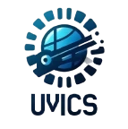

<p align="center">
  
</p>

<h1 align="center">UVICS Website</h1>

<p align="center">
  Website resmi <strong>Unklab Virtue in Computer Science</strong> untuk profil organisasi, informasi batch, showcase, media, FAQ, rekrutmen, dan dashboard admin.
</p>

## Status proyek

Proyek menggunakan pendekatan **frontend-first**. Backend dapat ditambahkan ketika fitur membutuhkan autentikasi, API, database, analytics, atau penyimpanan produksi.

| Area | Status saat ini |
|:---|:---|
| Halaman publik | Berjalan dengan konten statis dari source code. |
| Rekrutmen | Dikendalikan melalui `lib/recruitment-config.ts`. |
| Login admin | Masih berupa halaman preview; autentikasi belum tersedia. |
| Pengumuman admin | Tersimpan di `localStorage` browser dan belum tersinkron ke halaman publik. |
| Media admin | Perubahan hanya bertahan selama halaman aktif dan kembali ke data awal setelah reload. |
| Profil admin | Menggunakan data mock/static; persistence belum terhubung. |
| Dashboard analytics | Menggunakan GA4 Data API dan membutuhkan environment variables server-side. |

Jangan menyimpan password, token, atau data sensitif di React state, `localStorage`, maupun `sessionStorage`.

## Teknologi utama

- Next.js 16 dan React 19
- TypeScript 7 untuk typecheck, dengan TypeScript 6 sebagai compatibility API untuk ESLint dan build Next.js
- Tailwind CSS 4
- Radix UI, Lucide React, Framer Motion
- Swiper, Embla Carousel, dan Recharts
- Google Analytics Data API

Versi lengkap dan source of truth dependency tersedia di [`package.json`](./package.json).

## Menjalankan proyek

### Prasyarat

- Node.js **24 LTS**
- npm yang disertakan bersama Node.js
- Git

### Instalasi

```bash
git clone https://github.com/WEBUVICS/frontend.git
cd frontend
npm install
npm run dev
```

Buka [http://localhost:3000](http://localhost:3000). Panduan pengelolaan konten tersedia di [http://localhost:3000/docs](http://localhost:3000/docs).

Halaman publik tidak membutuhkan environment variables. Untuk dashboard analytics, salin `.env.example` menjadi `.env.local`, kemudian isi kredensial GA4 yang valid.

PowerShell:

```powershell
Copy-Item .env.example .env.local
```

Bash:

```bash
cp .env.example .env.local
```

## Environment variables

| Nama | Digunakan untuk | Visibilitas |
|:---|:---|:---|
| `GA4_PROPERTY_ID` | ID properti Google Analytics 4 | Server only |
| `GA4_CLIENT_EMAIL` | Email service account Google | Server only |
| `GA4_PRIVATE_KEY` | Private key service account dengan newline `\n` | Server only |

Gunakan `.env.local` untuk nilai asli. Jangan commit file tersebut dan jangan memindahkan secret ke variable dengan prefix `NEXT_PUBLIC_`.

## Script

| Perintah | Fungsi |
|:---|:---|
| `npm run dev` | Menjalankan development server. |
| `npm run lint` | Memeriksa kode dengan ESLint. |
| `npm run typecheck` | Memeriksa type dengan compiler TypeScript 7 tanpa menghasilkan file. |
| `npm run build` | Membuat production build. |
| `npm run start` | Menjalankan production build yang sudah dibuat. |

Sebelum pull request atau deployment, jalankan:

```bash
npm run lint
npm run typecheck
npm run build
```

## Struktur proyek

```text
frontend/
├── app/
│   ├── (user)/          # Halaman publik
│   ├── (admin)/         # Dashboard dan halaman admin
│   ├── api/analytics/   # Endpoint server untuk GA4
│   ├── docs/            # Panduan pengelolaan konten
│   ├── login/           # Preview akses admin
│   └── globals.css
├── components/
│   ├── adminComponents/
│   ├── analytics/
│   ├── showcase/
│   ├── ui/
│   └── userComponents/
├── lib/                 # Analytics, konfigurasi rekrutmen, dan utility
├── public/              # Aset statis
├── types/               # Type bersama
├── AGENTS.md            # Aturan kerja coding agent
├── BRANCH.md            # Workflow branch dan pull request
└── package.json
```

## Memperbarui konten

Referensi lengkap berada di halaman [`/docs`](http://localhost:3000/docs). Lokasi utama:

| Konten | Source of truth |
|:---|:---|
| Rekrutmen | `lib/recruitment-config.ts` |
| Anggota batch | `app/(user)/department/<batch>/page.tsx` |
| Showcase | `app/(user)/showcase/mockData.ts` |
| Event | `app/(user)/media/dataEvent.ts` |
| Pengumuman publik | `app/(user)/media/dataAnnounce.ts` |
| Galeri | Daftar gambar di `app/(user)/media/page.tsx` dan file di `public/gallery/` |
| FAQ | Array `faqs` di `app/(user)/faqs/page.tsx` |

Gunakan gambar WebP bila memungkinkan, optimalkan ukurannya sebelum commit, dan pastikan huruf besar/kecil pada path sama persis dengan nama file.

## Kontribusi

1. Baca [`AGENTS.md`](./AGENTS.md) untuk batas kerja dan aturan keamanan.
2. Ikuti [`BRANCH.md`](./BRANCH.md) untuk penamaan branch, commit, dan pull request.
3. Pisahkan perubahan yang tidak berkaitan.
4. Sertakan screenshot bila mengubah UI.
5. Jangan commit secret, hasil build, atau dependency lokal.
6. Setelah task selesai dan lolos verifikasi, commit lalu push ke upstream branch aktif dengan pesan yang jelas dan terstruktur.

## Deployment

Proyek dapat dibangun pada platform yang mendukung Next.js 16 dan Node.js 24 LTS. Jika dashboard analytics digunakan, tambahkan seluruh variable GA4 pada environment server platform hosting.

Autentikasi dan persistence admin belum production-ready. Jangan membuka dashboard sebagai sistem administrasi publik sebelum kontrol akses server-side tersedia.

## Kontak

- Instagram: [@uvics_id](https://www.instagram.com/uvics_id/)
- LinkedIn: [UVICS UNKLAB](https://www.linkedin.com/company/uvics-unklab-virtue-in-computer-science/)
- GitHub: [WEBUVICS](https://github.com/WEBUVICS)
- Email: [uvics@unklab.ac.id](mailto:uvics@unklab.ac.id)

## Hak penggunaan

Proyek ini dikembangkan untuk UVICS — Universitas Klabat. Tidak ada lisensi publik yang diberikan; penggunaan atau distribusi di luar organisasi memerlukan izin tertulis.
